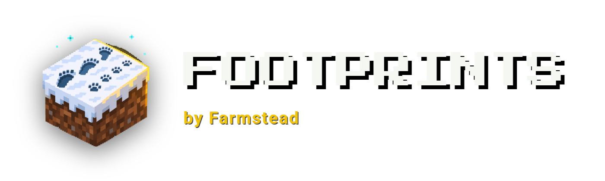
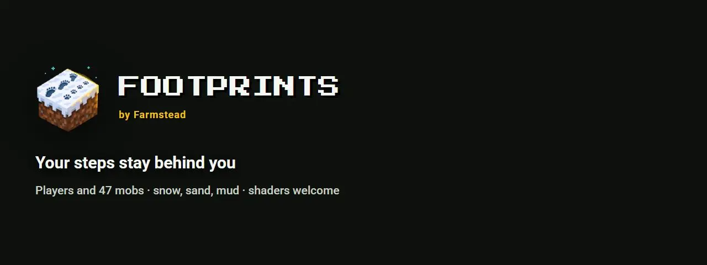
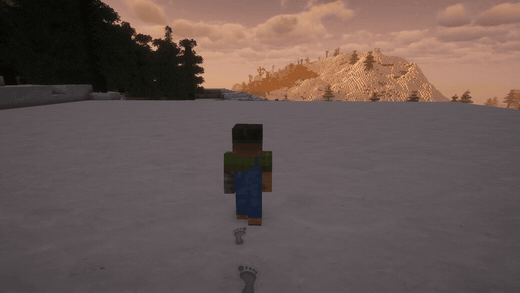
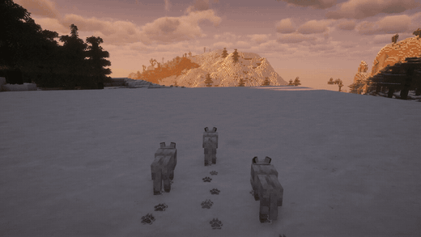
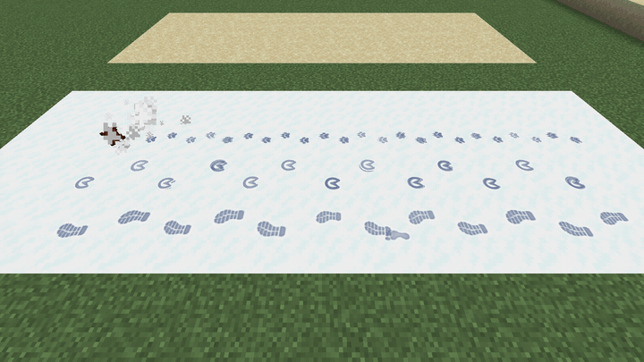
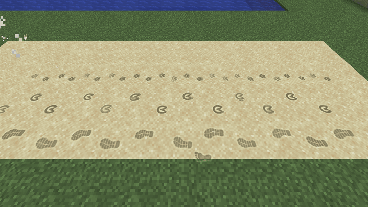
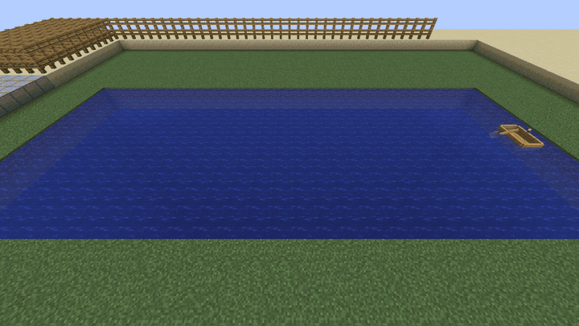
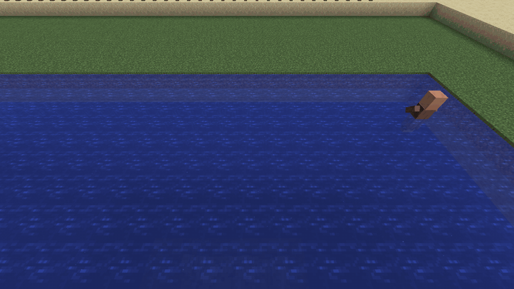
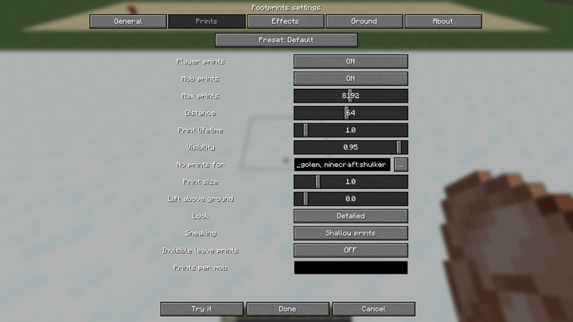
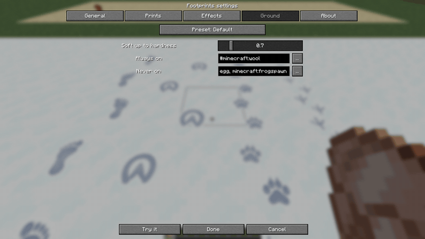

<p align="center"></p>

<p align="center"></p>

# Footprints

**Realistic footprints for players and mobs.** Walk through snow, sand or mud and your steps stay behind you, pressed into the ground, lit like the blocks around them, fading over time. Wolves leave paw prints, horses leave hooves, chickens leave three-toed scratches. Client-side: install it and it works on any server, vanilla included.

[](https://modrinth.com/mod/farmstead-footprints)
[](https://www.curseforge.com/minecraft/mc-mods/farmstead-footprints)
[](LICENSE)

By [Farmstead](https://farmsteadminecraft.online). Русская версия — [README.ru.md](README.ru.md).

## See it

| | |
| --- | --- |
|  |  |
| Your trail grows behind you | Every mob has its own tracks |
|  |  |
| Old prints crumble from the edges in | Two looks: detailed and pixel |
|  |  |
| Boats leave a wake | Rings where you wade |
|  |  |
| "Try it" stamps prints where you look | Searchable block and mob lists |

More pictures in [docs/media/gallery](docs/media/gallery).

## Features

- **Two looks.** *Detailed* (default): a shadowed hollow and a lit lip, coloured from the ground: blue shadows in snow, darker sand, a wet sheen in dark mud. *Pixel*: the block's own texture pixels pressed in, the north-west wall in shadow like a vanilla texture, matching rotated grass tops and biome tints.
- **Players and 47 mobs**, each with its own foot: boots or bare feet, paws, cat paws, hooves, cloven hooves, bird feet, bear paws, camel feet, the giant feet of golems, ravagers and wardens. Babies and scaled mobs (the scale attribute, Pehkui, Random Mob Sizes) leave prints to their size.
- **Modded mobs** get feet read from their model: the cubes that touch the ground are the feet, two make a biped, more make four, six or eight legs at their real positions. Mobs drawn without vanilla model parts (GeckoLib) fall back to a guess from the hitbox.
- **A real gait.** Two-legged walkers alternate left and right; four-legged animals put the hind foot into the print of the front foot on the same side; rabbits and frogs land in groups of four.
- **Any soft ground.** Every block softer than `surfaces.hardnessGate` takes prints, modded ones too; lists by id or #tag add or exclude blocks. Snow, sand, mud, grass, gravel, soil, clay and soul blocks have their own colour and lifetime. Thin snow layers count.
- **Prints age.** Over the second half of their life they crumble from the edges in (`effects.decay = FADE` just fades them). Rain and snowfall wear exposed prints faster. A print goes when its block is broken or replaced.
- **Water.** Boats leave a foam wake and throw spray, rings spread where you wade, bubbles trail swimmers, wet feet leave damp prints on stone and planks and throw droplets. Fast minecarts spark on the rails.
- **Your own prints** from PNG files or resource packs, see below.
- **Fast.** One draw per frame from geometry cached when a print is placed, culled to the camera's view.
- **Shaders welcome.** Works with Sodium and Iris (tested with Complementary Unbound).
- **Settings for everyone:** tabs, searchable block and mob pickers, an About tab with the update status, "Try it" to see the current settings on the ground, presets in one line, a commented config file, `/footprints reload`.
- **12 languages:** English, Russian, Chinese (Simplified), Portuguese (Brazil), Spanish, German, French, Polish, Ukrainian, Japanese, Korean, Turkish.

## Your own prints

- **Pictures.** Put a PNG into `config/farmstead_footprints/textures/` (one foot, toes up, dark on white or a shape on transparent). The file name is the shape name. Give it to a mob or a #tag in `footprints.profiles`: `"minecraft:player = shape:wolf_paw"`, `"#minecraft:skeletons = shape:bone size:0.8"`. `/footprints reload` picks up new files.
- **Variants.** `shape:paw|star|bird` picks one per print.
- **Profiles.** `<id or #tag> = shape:<name> size:<x> legs:<2|4|6|8> stride:<blocks> stance:<blocks> length:<blocks>`, any part optional. An exact id beats a tag; otherwise the first matching line wins.
- **Resource packs and mods** can ship:
  - shapes: `assets/<ns>/textures/farmstead_footprints/shapes/<name>.png`;
  - replacements for `assets/farmstead_footprints/textures/footprints_shadow.png` and `footprints_rim.png` (256x256, 4x4 cells);
  - rules: `assets/<ns>/farmstead_footprints/profiles/<any>.json` with `{"profiles": [...], "surfaces": {"include": [...], "exclude": [...]}}` in the config's syntax. The player's own config lines come first. F3+T reloads everything.

## Downloads and versions

| Minecraft | Fabric / Quilt | NeoForge | Forge | Java |
| --- | --- | --- | --- | --- |
| 26.1 – 26.3 | yes | yes | — | 25 |
| 1.21.7 – 1.21.11 | yes | yes | — | 21 |
| 1.21 – 1.21.5 | yes | yes | — | 21 |
| 1.20.1 | yes | — | yes | 17 |

On 26.x boat wakes and ripples are drawn as foam particles (the game draws custom geometry before the water there). 1.21.6 is not covered.

Get it from [Modrinth](https://modrinth.com/mod/farmstead-footprints), [CurseForge](https://www.curseforge.com/minecraft/mc-mods/farmstead-footprints) or [GitHub Releases](https://github.com/shtanko-michael/farmstead-footprints/releases).

**Requirements: none.** No library, not even Fabric API on Fabric: the jar is all you need. [Mod Menu](https://modrinth.com/mod/modmenu) is optional and adds a settings button on Fabric.

**Server or client?** Client only. The server does not need it, and you can join any server with it. Installed on a dedicated server it only writes its start-up line to the log and checks for updates.

## Settings

Open them from Mod Menu (Fabric) or the mod list (NeoForge, Forge), type `/footprints config`, or edit `config/farmstead_footprints-client.toml`.

| Key | Default | Range | What it does |
| --- | --- | --- | --- |
| `preset` | `default` | `default`, `vanilla_plus`, `cinematic`, `performance` | Sets every value below at once |
| `general.enabled` | `true` | | Master switch |
| `general.checkUpdates` | `true` | | Look for a newer version on Modrinth once at start-up (see below) |
| `footprints.players` | `true` | | Prints of players, yourself included |
| `footprints.mobs` | `true` | | Prints of animals and monsters |
| `footprints.maxPrints` | `2048` | 64 – 16384 | Prints alive at once; the oldest go first |
| `footprints.renderDistance` | `48` | 8 – 128 | Blocks from the camera where prints are made and drawn |
| `footprints.lifetimeMultiplier` | `1.0` | 0.1 – 10.0 | How long prints stay |
| `footprints.opacity` | `0.95` | 0.1 – 1.0 | How strongly prints show |
| `footprints.entityBlacklist` | flying and footless mobs | ids, #tags | Entities that never leave prints |
| `footprints.sizeMultiplier` | `1.0` | 0.25 – 4.0 | Makes every print bigger or smaller |
| `footprints.lift` | `0.0` | -0.05 – 0.5 | Raises prints above the ground (for shader packs) |
| `footprints.style` | `DETAILED` | `DETAILED`, `PIXEL` | Smooth prints, or the block's own pixels pressed in |
| `footprints.sneaking` | `SHALLOW` | `SHALLOW`, `NONE` | Sneaking leaves shallow prints or none |
| `footprints.invisible` | `false` | | Invisible players and mobs leave prints too |
| `footprints.profiles` | `[]` | lines | Prints per mob or #tag, see [Your own prints](#your-own-prints) |
| `effects.wetPrints` / `wetSeconds` / `wetOpacity` | `true` / `10` / `1.0` | | Damp prints on hard ground after water or rain |
| `effects.splash` | `ALL` | `OFF`, `PLAYERS`, `ALL` | Droplets from wet feet |
| `effects.ripples` / `boatWake` / `swimBubbles` / `railSparks` | `true` | | Water and rail effects |
| `effects.removeWhenBroken` | `true` | | A print goes with its block |
| `effects.decay` | `CRUMBLE` | `CRUMBLE`, `FADE` | How old prints go |
| `effects.rainWear` | `3.0` | 1 – 20 | How much faster rain wears exposed prints |
| `effects.dust` | `ALL` | `OFF`, `PLAYERS`, `ALL` | A puff from under the feet on loose ground |
| `surfaces.hardnessGate` | `0.7` | 0 – 5 | Any block softer than this takes prints |
| `surfaces.include` / `exclude` | wool / leaves, ice, … | ids, #tags | Blocks that always / never take prints |

Presets: **vanilla_plus** — no mob prints, half the lifetime, lighter; **cinematic** — 8192 prints, 96 blocks, three times longer; **performance** — 512 prints, 24 blocks, half the lifetime.

In the file, keys that follow the preset are written commented out (`#maxPrints = 2048`). Remove the `#` to set a value yourself; your value then wins over the preset. A wrong value is reported in the log, and in chat after `/footprints reload`, and the preset value is used instead: the game never crashes over the config.

## Commands

Client-side commands, available to every player:

| Command | What it does |
| --- | --- |
| `/footprints config` | Opens the settings screen |
| `/footprints reload` | Re-reads the config file and reports problems |
| `/footprints stats` | Prints alive, the limit, and how many were drawn in the last frame |

The mod is client-side, so it has no server permissions. LuckPerms nodes come with the planned server module (trails worn into grass).

## Update check and privacy

When the game starts, Footprints writes one line to the log:

```
[Farmstead] Footprints 0.1.0 started (neoforge, Minecraft 1.21.1) - https://modrinth.com/mod/farmstead-footprints
```

Then, once per session and in the background, it asks the public Modrinth API whether a newer release exists for your loader and Minecraft version. If one does, the log says so with a download link. The request carries no information about you, your world or your server; nothing is downloaded or installed. Turn it off with `general.checkUpdates = false`, or for every Farmstead mod at once with the JVM flag `-Dfarmstead.updateCheck=false` or the environment variable `FARMSTEAD_UPDATE_CHECK=false`.

## Compatibility

- **Sodium, Iris**: supported. Prints are drawn after the world, so shader packs light them; `footprints.lift` raises them if a shader pack's deep ground hides them.
- **Other footprint mods** (FootprintParticle, Soft Imprints): both will draw their prints; keep one.
- **Modded blocks and mobs**: soft modded blocks take prints by hardness, modded mobs get feet from their model; both can be tuned by id or #tag.

## FAQ

**Do other players see my prints?** Everyone who has the mod sees everyone's prints, players and mobs alike, computed on their own client. Players without the mod see nothing.

**Is it heavy?** Prints are drawn in one batch per frame and capped by `maxPrints`. On a weak machine pick the `performance` preset.

**Prints on grass?** Yes: grass, moss and other soft blocks take prints. Exclude any block in the Ground tab.

## Planned

Trails worn into grass that stay (server module with LuckPerms permissions), Minecraft 1.16.5–1.19.

## Building from source

Gradle runs on **JDK 25** (Stonecutter 0.10); the Java 17 and 21 toolchains are downloaded automatically.

```
./gradlew build                          # all six targets -> versions/<target>/build/libs
./gradlew :1.21.1-neoforge:runClient     # dev client of one target
python -I tools/lang.py --check          # all 12 language files are complete
```

## License

Code: [MIT](LICENSE). Assets (textures, images, video): [CC BY-NC 4.0](https://creativecommons.org/licenses/by-nc/4.0/). Modpacks may include the mod freely.

Made by [Farmstead](https://farmsteadminecraft.online). Bugs and ideas: [GitHub Issues](https://github.com/shtanko-michael/farmstead-footprints/issues).
