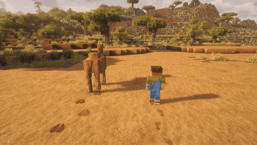
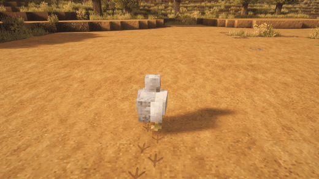

<p align="center"></p>

<p align="center"></p>

# Footprints

**Реалистичные следы игроков и мобов.** Пройдите по снегу, песку или грязи — шаги останутся позади: вдавленные в землю, освещённые так же, как блоки вокруг, и постепенно исчезающие. Волки оставляют отпечатки лап, лошади — копыт, куры — трёхпалые царапины. Мод клиентский: поставили — и он работает на любом сервере, включая ванильный.

[](https://modrinth.com/mod/farmstead-footprints)
[](https://www.curseforge.com/minecraft/mc-mods/farmstead-footprints)
[](LICENSE)

От [Farmstead](https://farmsteadminecraft.online). English version — [README.md](README.md).

## Как это выглядит

| | |
| --- | --- |
|  |  |
| Цепочка следов растёт за вами | У каждого моба свои следы |
|  |  |
| Песок, красный песок, грязь, гравий, земля | Даже самые маленькие лапки |

Ещё картинки — в [docs/media/gallery](docs/media/gallery).

## Возможности

- **След вдавлен, а не нарисован.** У каждого отпечатка есть углубление и приподнятый край, а цвет берётся от земли под ним: синие тени на снегу, тёмный песок на песке, влажный блеск в тёмной грязи.
- **Игроки и 47 мобов**, у каждого своя стопа: ботинки или босая нога, лапы, кошачьи лапы, копыта, раздвоенные копыта, птичьи лапы, медвежьи лапы, верблюжьи ноги, огромные ступни големов, разорителей и стражей. Дети и маленькие зомби оставляют следы поменьше.
- **Настоящая походка.** Двуногие ступают поочерёдно левой и правой; у четвероногих задняя лапа встаёт в след передней с той же стороны — как на настоящих следах.
- **Поверхности:** снег и рыхлый снег, песок и красный песок, грязь и илистые корни мангров, гравий, земля, каменистая земля, корнистая земля, подзол, мицелий, пашня, глина, песок и почва душ. Тонкий слой снега учитывается: след ложится поверх снега, а не под него.
- **Следы исчезают.** На снегу держатся около пяти минут, в грязи — четыре, на песке — три, на гравии — полторы; одной настройкой это время можно растянуть или сократить.
- **Дружит с шейдерами.** Работает с Sodium и Iris (проверено на Complementary Unbound).
- **Удобные настройки:** пресеты одной строкой (`default`, `vanilla_plus`, `cinematic`, `performance`), экран настроек в игре (Mod Menu на Fabric, список модов на NeoForge и Forge), файл конфига с комментариями и `/footprints reload`.
- **12 языков:** английский, русский, китайский (упрощённый), португальский (Бразилия), испанский, немецкий, французский, польский, украинский, японский, корейский, турецкий.

## Скачать и версии

| Minecraft | Fabric / Quilt | NeoForge | Forge | Java |
| --- | --- | --- | --- | --- |
| 26.3 | да | да | — | 25 |
| 1.21 – 1.21.1 | да | да | — | 21 |
| 1.20.1 | да | — | да | 17 |

Скачать: [Modrinth](https://modrinth.com/mod/farmstead-footprints), [CurseForge](https://www.curseforge.com/minecraft/mc-mods/farmstead-footprints) или [релизы на GitHub](https://github.com/shtanko-michael/farmstead-footprints/releases).

**Что нужно: ничего.** Ни одной библиотеки, даже Fabric API на Fabric: достаточно самого jar. [Mod Menu](https://modrinth.com/mod/modmenu) не обязателен, он добавляет кнопку настроек на Fabric.

**Клиент или сервер?** Только клиент. Серверу мод не нужен, с ним можно заходить на любой сервер. На выделенном сервере он только пишет строку о запуске в лог и проверяет обновления.

## Настройки

Открыть: через Mod Menu (Fabric) или список модов (NeoForge, Forge), командой `/footprints config` или в файле `config/farmstead_footprints-client.toml`.

| Ключ | По умолчанию | Диапазон | Что делает |
| --- | --- | --- | --- |
| `preset` | `default` | `default`, `vanilla_plus`, `cinematic`, `performance` | Задаёт все значения ниже разом |
| `general.enabled` | `true` | | Главный выключатель |
| `general.checkUpdates` | `true` | | Один раз при запуске проверить новую версию на Modrinth (см. ниже) |
| `footprints.players` | `true` | | Следы игроков, включая ваши |
| `footprints.mobs` | `true` | | Следы животных и монстров |
| `footprints.maxPrints` | `2048` | 64 – 16384 | Сколько следов живёт одновременно; первыми исчезают старые |
| `footprints.renderDistance` | `48` | 8 – 128 | В скольких блоках от камеры следы появляются и рисуются |
| `footprints.lifetimeMultiplier` | `1.0` | 0.1 – 10.0 | Сколько держатся следы |
| `footprints.opacity` | `0.95` | 0.1 – 1.0 | Насколько заметны следы |
| `footprints.entityBlacklist` | `[]` | id сущностей | Кто никогда не оставляет следов, например `["minecraft:villager"]` |

Пресеты: **vanilla_plus** — без следов мобов, вдвое короче и бледнее; **cinematic** — 8192 следа, 96 блоков, втрое дольше; **performance** — 512 следов, 24 блока, вдвое короче.

В файле ключи, которые следуют пресету, записаны закомментированными (`#maxPrints = 2048`). Уберите `#`, чтобы задать значение самому, — тогда оно важнее пресета. Ошибочное значение попадает в лог (и в чат после `/footprints reload`), а вместо него берётся значение пресета: из-за конфига игра не падает.

## Команды

Клиентские команды, доступны любому игроку:

| Команда | Что делает |
| --- | --- |
| `/footprints config` | Открывает экран настроек |
| `/footprints reload` | Перечитывает конфиг и сообщает о проблемах |
| `/footprints stats` | Сколько следов живо, лимит и сколько нарисовано в последнем кадре |

Мод клиентский, поэтому серверных прав у него нет. Узлы LuckPerms появятся вместе с серверным модулем (протоптанные тропинки).

## Проверка обновлений и приватность

При запуске игры Footprints пишет в лог одну строку:

```
[Farmstead] Footprints 0.1.0 started (neoforge, Minecraft 1.21.1) - https://modrinth.com/mod/farmstead-footprints
```

Затем один раз за сессию, в фоне, он спрашивает публичный API Modrinth, нет ли более новой версии для вашего загрузчика и версии Minecraft. Если есть — пишет об этом в лог со ссылкой на скачивание. В запросе нет никаких данных о вас, вашем мире или сервере; ничего не скачивается и не устанавливается. Выключить: `general.checkUpdates = false`, а для всех модов Farmstead сразу — флаг JVM `-Dfarmstead.updateCheck=false` или переменная окружения `FARMSTEAD_UPDATE_CHECK=false`.

## Совместимость

- **Sodium, Iris** — поддерживаются. Следы рисуются после мира, поэтому шейдерпаки их освещают.
- **Другие моды на следы** (FootprintParticle и похожие) — нарисуют свои следы вместе с нашими; оставьте один.
- **Блоки и мобы из других модов** — в 0.1 только ванильные. Теги для модовых поверхностей и существ в планах.

## Вопросы

**Видят ли другие игроки мои следы?** Все, у кого стоит мод, видят следы всех игроков и мобов — каждый клиент считает их сам. Игроки без мода не видят ничего.

**Тяжёлый ли мод?** Следы рисуются одной пачкой за кадр, их число ограничено `maxPrints`. На слабом компьютере выберите пресет `performance`.

**Почему нет следов на траве?** В 0.1 трава не считается мягкой поверхностью. Протоптанные в траве тропинки в планах.

## В планах

Тропинки, которые протаптываются в траве и остаются (серверный модуль с правами LuckPerms), мокрые следы после дождя и воды, модовые поверхности и мобы через теги блоков и сущностей.

## Сборка из исходников

Gradle запускается на **JDK 25** (Stonecutter 0.10); тулчейны Java 17 и 21 скачиваются сами.

```
./gradlew build                          # все шесть целей -> versions/<цель>/build/libs
./gradlew :1.21.1-neoforge:runClient     # клиент для разработки одной цели
python -I tools/lang.py --check          # все 12 языковых файлов полные
```

## Лицензия

Код — [MIT](LICENSE). Ассеты (текстуры, картинки, видео) — [CC BY-NC 4.0](https://creativecommons.org/licenses/by-nc/4.0/). Включать мод в сборки можно свободно.

Сделано [Farmstead](https://farmsteadminecraft.online). Ошибки и идеи — [GitHub Issues](https://github.com/shtanko-michael/farmstead-footprints/issues).
