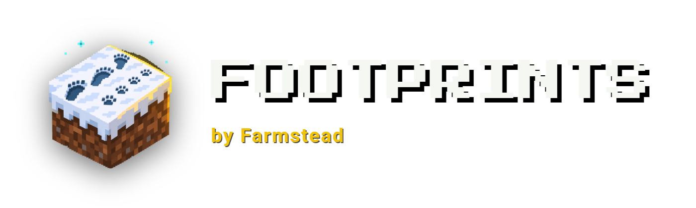
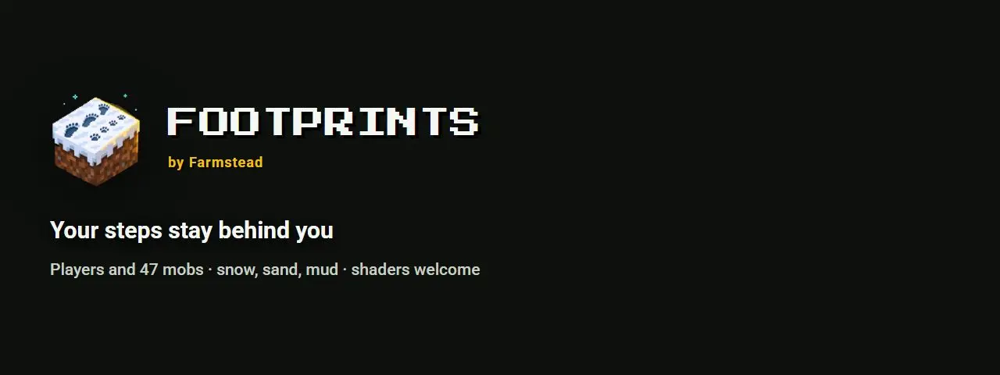
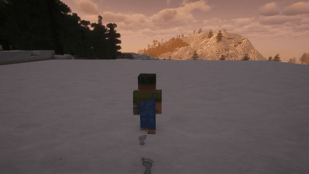
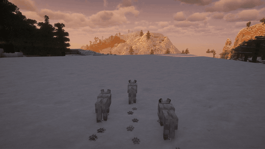
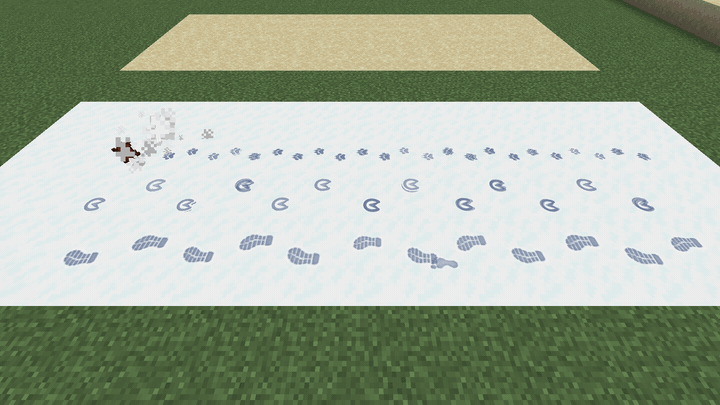
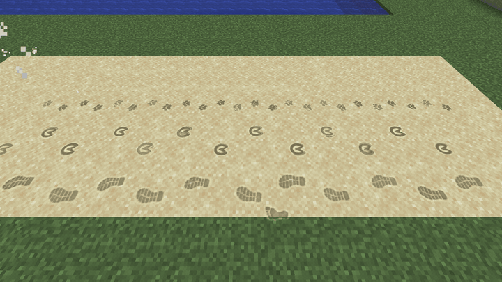
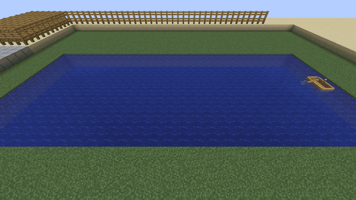
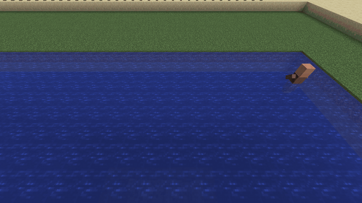
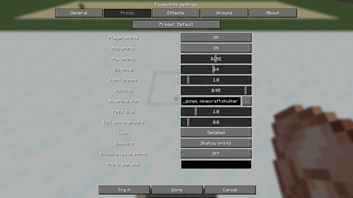
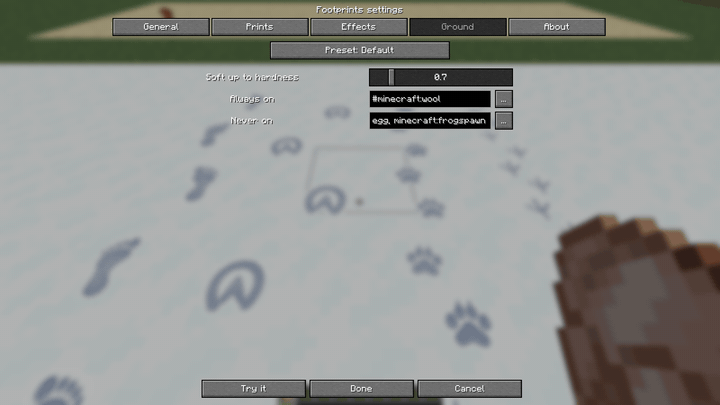

<p align="center"></p>

<p align="center"></p>

# Footprints

**Реалистичные следы игроков и мобов.** Пройдите по снегу, песку или грязи — шаги останутся позади: вдавленные в землю, освещённые так же, как блоки вокруг, и постепенно исчезающие. Волки оставляют отпечатки лап, лошади — копыт, куры — трёхпалые царапины. Мод клиентский: поставили — и он работает на любом сервере, включая ванильный.

[](https://modrinth.com/mod/farmstead-footprints)
[](https://www.curseforge.com/minecraft/mc-mods/farmstead-footprints)
[](LICENSE)

От [Farmstead](https://farmsteadminecraft.online). English version — [README.md](README.md).

## Как это выглядит

| | |
| --- | --- |
|  |  |
| Ваша тропа тянется следом | У каждого моба свои следы |
|  |  |
| Старые следы осыпаются от краёв | Два вида: детальный и пиксельный |
|  |  |
| За лодкой остаётся пена | Круги там, где идут вброд |
|  |  |
| «Показать» печатает следы там, куда вы смотрите | Поиск блоков и мобов |

Больше картинок в [docs/media/gallery](docs/media/gallery).

## Возможности

- **Два вида.** *Детальный* (по умолчанию): затенённая впадина и освещённый край, цвет от грунта — синие тени на снегу, тёмный песок, мокрый блеск на грязи. *Пиксельный*: вдавлены сами пиксели текстуры блока, северо-западная стенка в тени, как в ванильных текстурах; совпадает с повёрнутыми текстурами травы и цветом биома.
- **Игроки и 47 мобов**, у каждого своя стопа: ботинки или босые ноги, лапы, кошачьи лапы, копыта, раздвоенные копыта, птичьи лапы, медвежьи лапы, верблюжьи ноги, огромные ступни големов, разорителей и стражей. Детёныши и увеличенные мобы (атрибут scale, Pehkui, Random Mob Sizes) оставляют следы по размеру.
- **Модовые мобы** получают ноги из своей модели: кубы, касающиеся земли, — это ступни; две дают двуногого, больше — четыре, шесть или восемь ног на настоящих местах. Мобы без ванильных частей модели (GeckoLib) — по хитбоксу.
- **Настоящая походка.** Двуногие ступают левой и правой по очереди; четвероногие ставят заднюю ногу в след передней той же стороны; кролики и лягушки приземляются группами по четыре.
- **Любой мягкий грунт.** Следы оставляет любой блок мягче `surfaces.hardnessGate`, модовые тоже; списками по id или #тегу блоки добавляются и исключаются. У снега, песка, грязи, травы, гравия, земли, глины и блоков душ свой цвет и срок. Тонкие слои снега тоже.
- **Следы стареют.** Во второй половине жизни осыпаются от краёв (`effects.decay = FADE` — просто бледнеют). Дождь и снегопад стирают следы под открытым небом быстрее. След исчезает, если блок под ним сломали или заменили.
- **Вода.** За лодкой пенный след и брызги, где идут вброд — круги, за пловцами пузыри, мокрые ноги оставляют влажные следы на камне и досках и брызги. Быстрые вагонетки искрят на рельсах.
- **Свои следы** из PNG или ресурспаков — см. ниже.
- **Быстро.** Один вызов отрисовки на кадр из геометрии, посчитанной при появлении следа, только то, что видит камера.
- **Шейдеры.** Работает с Sodium и Iris (проверено с Complementary Unbound).
- **Настройки для всех:** вкладки, поиск блоков и мобов, вкладка «О моде» со статусом обновлений, «Показать» — текущие настройки прямо на земле, пресеты одной строкой, конфиг с комментариями, `/footprints reload`.
- **12 языков:** английский, русский, китайский (упрощённый), португальский (Бразилия), испанский, немецкий, французский, польский, украинский, японский, корейский, турецкий.

## Свои следы

- **Картинки.** Положите PNG в `config/farmstead_footprints/textures/` (одна стопа, пальцы вверх, тёмное на белом или фигура на прозрачном). Имя файла — имя формы. Назначьте её мобу или #тегу в `footprints.profiles`: `"minecraft:player = shape:wolf_paw"`, `"#minecraft:skeletons = shape:bone size:0.8"`. `/footprints reload` подхватит новые файлы.
- **Варианты.** `shape:paw|star|bird` — для каждого следа случайный.
- **Профили.** `<id или #тег> = shape:<имя> size:<x> legs:<2|4|6|8> stride:<блоки> stance:<блоки> length:<блоки>`, любая часть необязательна. Точный id сильнее тега, иначе побеждает первая подходящая строка.
- **Ресурспаки и моды** могут добавить:
  - формы: `assets/<ns>/textures/farmstead_footprints/shapes/<имя>.png`;
  - замену `assets/farmstead_footprints/textures/footprints_shadow.png` и `footprints_rim.png` (256x256, сетка 4x4);
  - правила: `assets/<ns>/farmstead_footprints/profiles/<любое>.json` вида `{"profiles": [...], "surfaces": {"include": [...], "exclude": [...]}}` в синтаксисе конфига. Строки из конфига игрока идут первыми. F3+T перечитывает всё.

## Загрузка и версии

| Minecraft | Fabric / Quilt | NeoForge | Forge | Java |
| --- | --- | --- | --- | --- |
| 26.1 – 26.3 | да | да | — | 25 |
| 1.21.7 – 1.21.11 | да | да | — | 21 |
| 1.21 – 1.21.5 | да | да | — | 21 |
| 1.20.1 | да | — | да | 17 |

На 26.x пена за лодкой и круги на воде — частицы (игра там рисует свою геометрию раньше воды). 1.21.6 не поддерживается.

Скачать: [Modrinth](https://modrinth.com/mod/farmstead-footprints), [CurseForge](https://www.curseforge.com/minecraft/mc-mods/farmstead-footprints) или [релизы на GitHub](https://github.com/shtanko-michael/farmstead-footprints/releases).

**Что нужно: ничего.** Ни одной библиотеки, даже Fabric API на Fabric: достаточно самого jar. [Mod Menu](https://modrinth.com/mod/modmenu) не обязателен, он добавляет кнопку настроек на Fabric.

**Клиент или сервер?** Только клиент. Серверу мод не нужен, с ним можно заходить на любой сервер. На выделенном сервере он только пишет строку о запуске в лог и проверяет обновления.

## Настройки

Открыть: через Mod Menu (Fabric) или список модов (NeoForge, Forge), командой `/footprints config` или в файле `config/farmstead_footprints-client.toml`.

| Ключ | По умолчанию | Диапазон | Что делает |
| --- | --- | --- | --- |
| `preset` | `default` | `default`, `vanilla_plus`, `cinematic`, `performance` | Задаёт все значения ниже разом |
| `general.enabled` | `true` | | Главный выключатель |
| `general.checkUpdates` | `true` | | Один раз при запуске проверить новую версию на Modrinth (см. ниже) |
| `footprints.players` | `true` | | Следы игроков, включая ваши |
| `footprints.mobs` | `true` | | Следы животных и монстров |
| `footprints.maxPrints` | `2048` | 64 – 16384 | Сколько следов живёт одновременно; первыми исчезают старые |
| `footprints.renderDistance` | `48` | 8 – 128 | В скольких блоках от камеры следы появляются и рисуются |
| `footprints.lifetimeMultiplier` | `1.0` | 0.1 – 10.0 | Сколько держатся следы |
| `footprints.opacity` | `0.95` | 0.1 – 1.0 | Насколько заметны следы |
| `footprints.entityBlacklist` | летающие и безногие | id, #теги | Кто никогда не оставляет следов |
| `footprints.sizeMultiplier` | `1.0` | 0.25 – 4.0 | Все следы больше или меньше |
| `footprints.lift` | `0.0` | -0.05 – 0.5 | Приподнять следы над землёй (для шейдеров) |
| `footprints.style` | `DETAILED` | `DETAILED`, `PIXEL` | Гладкие следы или вдавленные пиксели самого блока |
| `footprints.sneaking` | `SHALLOW` | `SHALLOW`, `NONE` | Крадущийся оставляет мелкие следы или никаких |
| `footprints.invisible` | `false` | | Невидимые тоже оставляют следы |
| `footprints.profiles` | `[]` | строки | Следы по мобу или #тегу, см. [Свои следы](#свои-следы) |
| `effects.wetPrints` / `wetSeconds` / `wetOpacity` | `true` / `10` / `1.0` | | Мокрые следы на твёрдом после воды или дождя |
| `effects.splash` | `ALL` | `OFF`, `PLAYERS`, `ALL` | Брызги с мокрых ног |
| `effects.ripples` / `boatWake` / `swimBubbles` / `railSparks` | `true` | | Эффекты на воде и рельсах |
| `effects.removeWhenBroken` | `true` | | След исчезает вместе с блоком |
| `effects.decay` | `CRUMBLE` | `CRUMBLE`, `FADE` | Как исчезают старые следы |
| `effects.rainWear` | `3.0` | 1 – 20 | Во сколько раз быстрее дождь стирает следы |
| `effects.dust` | `ALL` | `OFF`, `PLAYERS`, `ALL` | Облачко из-под ног на рыхлом грунте |
| `surfaces.hardnessGate` | `0.7` | 0 – 5 | Следы оставляет любой блок мягче этого |
| `surfaces.include` / `exclude` | шерсть / листва, лёд, … | id, #теги | Блоки, которые всегда / никогда не принимают следы |

Пресеты: **vanilla_plus** — без следов мобов, вдвое короче и бледнее; **cinematic** — 8192 следа, 96 блоков, втрое дольше; **performance** — 512 следов, 24 блока, вдвое короче.

В файле ключи, которые следуют пресету, записаны закомментированными (`#maxPrints = 2048`). Уберите `#`, чтобы задать значение самому, — тогда оно важнее пресета. Ошибочное значение попадает в лог (и в чат после `/footprints reload`), а вместо него берётся значение пресета: из-за конфига игра не падает.

## Команды

Клиентские команды, доступны любому игроку:

| Команда | Что делает |
| --- | --- |
| `/footprints config` | Открывает экран настроек |
| `/footprints reload` | Перечитывает конфиг и сообщает о проблемах |
| `/footprints stats` | Сколько следов живо, лимит и сколько нарисовано в последнем кадре |

Мод клиентский, поэтому серверных прав у него нет. Узлы LuckPerms появятся вместе с серверным модулем (протоптанные тропинки).

## Проверка обновлений и приватность

При запуске игры Footprints пишет в лог одну строку:

```
[Farmstead] Footprints 0.1.0 started (neoforge, Minecraft 1.21.1) - https://modrinth.com/mod/farmstead-footprints
```

Затем один раз за сессию, в фоне, он спрашивает публичный API Modrinth, нет ли более новой версии для вашего загрузчика и версии Minecraft. Если есть — пишет об этом в лог со ссылкой на скачивание. В запросе нет никаких данных о вас, вашем мире или сервере; ничего не скачивается и не устанавливается. Выключить: `general.checkUpdates = false`, а для всех модов Farmstead сразу — флаг JVM `-Dfarmstead.updateCheck=false` или переменная окружения `FARMSTEAD_UPDATE_CHECK=false`.

## Совместимость

- **Sodium, Iris**: поддерживаются. Следы рисуются после мира, шейдеры их освещают; `footprints.lift` приподнимет их, если рельефная земля шейдерпака их прячет.
- **Другие моды следов** (FootprintParticle, Soft Imprints): будут рисовать оба; оставьте один.
- **Модовые блоки и мобы**: мягкие модовые блоки получают следы по прочности, модовые мобы — ноги из модели; всё настраивается по id или #тегу.

## FAQ

**Видят ли другие мои следы?** Все, у кого стоит мод, видят следы всех — и игроков, и мобов, — каждый считает их у себя. Без мода не видно ничего.

**Не тяжело ли?** Все следы рисуются одной пачкой за кадр, их число ограничено `maxPrints`. На слабом ПК — пресет `performance`.

**Следы на траве?** Да: трава, мох и другие мягкие блоки принимают следы. Любой блок можно исключить во вкладке «Поверхности».

## В планах

Протоптанные тропинки в траве, которые остаются (серверный модуль с правами LuckPerms), Minecraft 1.16.5–1.19.

## Сборка из исходников

Gradle запускается на **JDK 25** (Stonecutter 0.10); тулчейны Java 17 и 21 скачиваются сами.

```
./gradlew build                          # все шесть целей -> versions/<цель>/build/libs
./gradlew :1.21.1-neoforge:runClient     # клиент для разработки одной цели
python -I tools/lang.py --check          # все 12 языковых файлов полные
```

## Лицензия

Код — [MIT](LICENSE). Ассеты (текстуры, картинки, видео) — [CC BY-NC 4.0](https://creativecommons.org/licenses/by-nc/4.0/). Включать мод в сборки можно свободно.

Сделано [Farmstead](https://farmsteadminecraft.online). Ошибки и идеи — [GitHub Issues](https://github.com/shtanko-michael/farmstead-footprints/issues).
