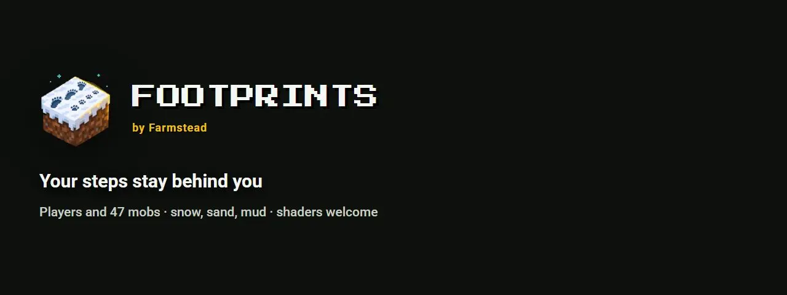
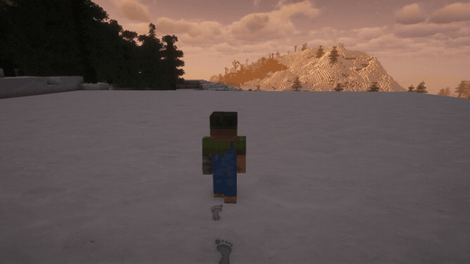
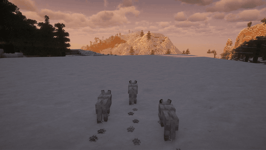
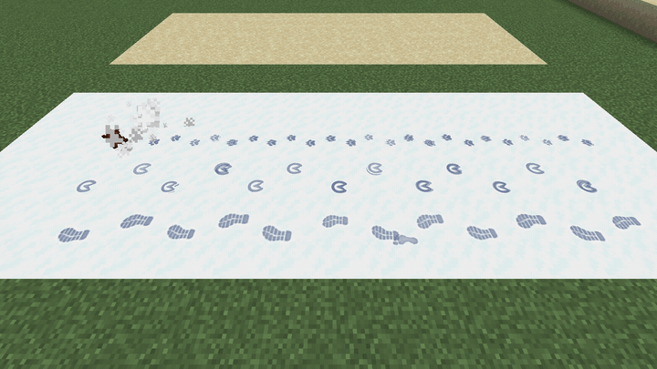
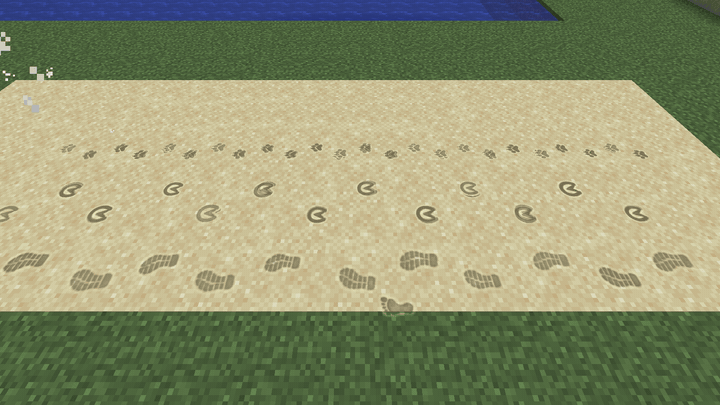
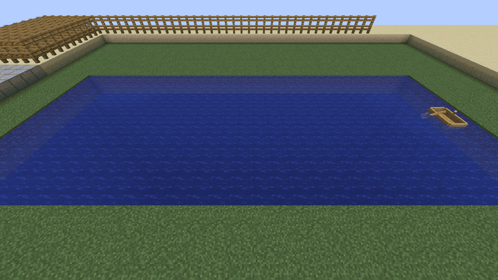
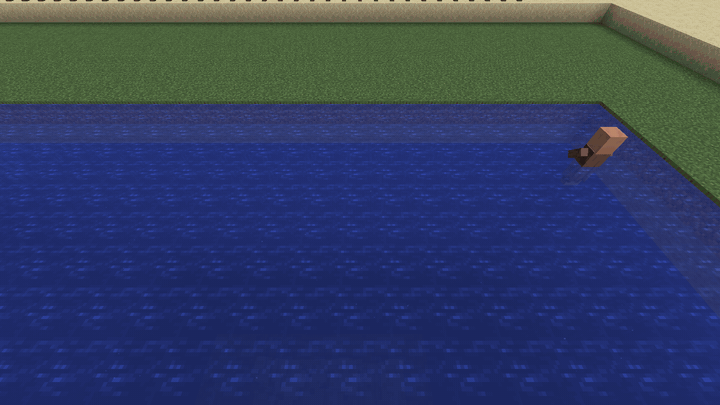
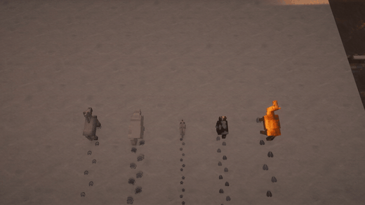
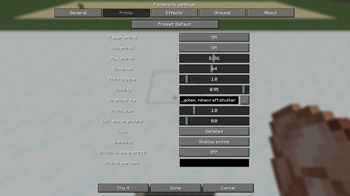

# Your steps stay behind you

**Footprints** presses real tracks into the world. Walk through snow, sand or mud and every step is left behind you: a hollow with a raised lip, coloured by the ground it sits in, lit by the same sun and shaders as everything around it, slowly crumbling away.

And it is not only you. **47 mobs** leave their own tracks, and **modded mobs** get feet read from their own models: wolves trot past in a carpet of paw prints, horses leave hooves, camels two-toed pads, polar bears huge clawed paws, chickens tiny three-toed scratches. Boats leave a foam wake, waders leave rings on the water.

**Client-side, zero dependencies.** Install it and it works on any server, vanilla included. No server mod, no resource pack, not even Fabric API.

---

## See it

| | |
| --- | --- |
|  **Your trail stays behind you** |  **Every mob leaves its own prints** |
|  **Old prints crumble from the edges in** |  **Two looks: detailed and pixel** |
|  **Boats leave a foam wake** |  **Rings spread where you wade** |
|  **Real gaits: hind foot in the front print** |  **Settings with a live "Try it"** |

## What makes it different

- **Two looks.** *Detailed*: a shadowed hollow and a lit lip, the block texture showing through. *Pixel*: the block's own texture pixels pressed in, shaded like a vanilla texture, matching rotated grass tops and biome tints.
- **A real gait.** People step left, right, left. Four-legged animals put the hind foot into the front print of the same side, exactly like real animal tracks.
- **Every foot is its own.** Boots or bare feet, paws, cat paws, hooves, cloven hooves, bird feet, bear paws, camel feet, the giant feet of iron golems, ravagers and wardens. Babies and scaled mobs (Pehkui, Random Mob Sizes, the scale attribute) leave prints to their size.
- **Modded mobs, out of the box.** Feet are read from the mob's model: two feet make a biped, more make four, six or eight legs at their real positions.
- **Prints age.** They crumble from the edges in over the second half of their life; rain and snowfall wear exposed prints faster. A print goes when its block is broken.
- **Water and wet feet.** Foam wakes behind boats, rings where you wade, bubbles behind swimmers, damp prints on stone and planks after a swim or rain, droplets from wet feet. Sparks under fast minecarts.
- **Fast.** All prints are drawn in one batch from cached geometry, culled to what the camera sees.
- **Shaders welcome.** Works with **Sodium** and **Iris**; shader packs light the prints like the ground.

## Your own prints

- Drop a PNG into `config/farmstead_footprints/textures/` and give it to any mob or #tag: `"minecraft:player = shape:wolf_paw"`. The mod trims it and draws the hollow and the lip itself.
- Random variants per print: `shape:paw|star|bird`.
- **Resource packs and mods** can add shapes, replace the base textures and ship rules (`assets/<ns>/farmstead_footprints/profiles/*.json`). F3+T picks up changes.

## Surfaces

Any block softer than a threshold you set takes prints, so modded soil and sand work without setup. Lists by id or #tag to include or exclude blocks. Snow, sand, mud, grass, gravel, soil, clay and soul blocks each have their own colour and lifetime.

## Settings for everyone

- **Tabs** for prints, effects and ground, **searchable pickers** for blocks and mobs, an **About** tab with the update status.
- **"Try it"**: stamps your, a horse's, a wolf's and a chicken's prints where you look, with the current settings.
- **One-line presets:** `default`, `vanilla_plus`, `cinematic`, `performance`.
- A commented config file; a wrong value never crashes the game, it is reported and replaced.
- Commands: `/footprints config`, `/footprints reload`, `/footprints stats`.

## 12 languages

English, Русский, 简体中文, Português (Brasil), Español, Deutsch, Français, Polski, Українська, 日本語, 한국어, Türkçe.

## Versions

| Minecraft | Loaders |
| --- | --- |
| 26.1 – 26.3 | Fabric, Quilt, NeoForge |
| 1.21.7 – 1.21.11 | Fabric, Quilt, NeoForge |
| 1.21 – 1.21.5 | Fabric, Quilt, NeoForge |
| 1.20.1 | Fabric, Quilt, Forge |

**No dependencies at all.** **[Mod Menu](https://modrinth.com/mod/modmenu)** is optional on Fabric. On 26.x boat wakes and ripples are drawn as foam particles.

## FAQ

**Do other players see my prints?** Everyone who has the mod sees all prints, of players and mobs, computed on their own client.

**Is it heavy?** One draw per frame, a cap on prints you set, and a `performance` preset for weak PCs.

**Can I use it in a modpack?** Yes, freely.

**Does it phone home?** Once per start it asks the public Modrinth API whether a newer version exists. Nothing about you is sent. Turn it off with `checkUpdates = false` or `-Dfarmstead.updateCheck=false`.

---

Made by **[Farmstead](https://farmsteadminecraft.online)** · [Source](https://github.com/shtanko-michael/farmstead-footprints) · [Issues](https://github.com/shtanko-michael/farmstead-footprints/issues) · [Documentation](https://github.com/shtanko-michael/farmstead-footprints#readme) · Code MIT, assets CC BY-NC 4.0
